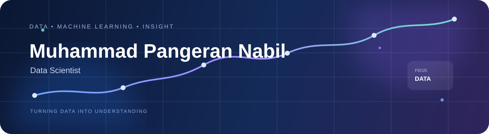
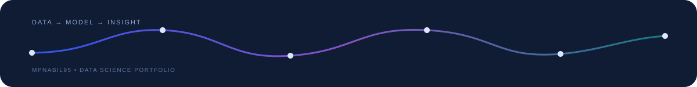

<!--
  GitHub Profile README
  Muhammad Pangeran Nabil (@mpnabil95)
  Profile repository: mpnabil95/mpnabil95

  Notes:
  - External SVG widgets are intentionally limited to a few high-value components.
  - Local SVG assets are used for the visual identity so the profile does not depend
    entirely on third-party banner services.
-->

<div align="center">

<a href="https://mpnabil95.github.io/nabil-portfolio/">
  
</a>

<br/>

### Data Scientist · Machine Learning · Data Analytics

<p>
  I build data-driven solutions by combining <b>data analysis</b>, <b>machine learning</b>,
  <b>visualization</b>, and <b>problem solving</b>.
</p>

<p>
  <a href="https://mpnabil95.github.io/nabil-portfolio/">
    
  </a>
  <a href="https://www.linkedin.com/in/mpnabil">
    
  </a>
  <a href="mailto:mpnabil95@gmail.com">
    
  </a>
</p>

</div>

---

## `01` — About Me

I'm **Muhammad Pangeran Nabil**, a university student in **Information Systems at Universitas AMIKOM Yogyakarta** with a growing focus on **Data Science**.

My interests sit at the intersection of:

- 📊 **Data Analytics & Visualization**
- 🤖 **Machine Learning**
- 🧠 **Natural Language Processing**
- 💡 **Problem Solving & Insight Generation**
- ⚙️ **Building practical data-driven applications**

I enjoy turning raw data into something that can be **understood, evaluated, and used to support decisions**.

> **Current direction:** building stronger foundations in statistics, machine learning, Python, and end-to-end data science workflows.

---

## `02` — What I Work With

<div align="center">

### Data Science

<a href="https://www.python.org/"></a>
<a href="https://pandas.pydata.org/"></a>
<a href="https://scikit-learn.org/"></a>
<a href="https://jupyter.org/"></a>

### Development & Tools

<a href="https://developer.mozilla.org/en-US/docs/Web/HTML"></a>
<a href="https://developer.mozilla.org/en-US/docs/Web/CSS"></a>
<a href="https://developer.mozilla.org/en-US/docs/Web/JavaScript"></a>
<a href="https://astro.build/"></a>
<a href="https://git-scm.com/"></a>
<a href="https://github.com/"></a>

</div>

> My toolkit is intentionally shown selectively. The goal is to highlight technologies that support my current direction rather than display every tool I have encountered.

---

## `03` — Featured Work

<table>
<tr>
<td width="50%" valign="top">

### 🛒 Olist E-Commerce Intelligence

An end-to-end **e-commerce analytics** project focused on extracting business insights from the Olist dataset.

**Focus**
- Exploratory Data Analysis
- Customer & order analysis
- Revenue / GMV insights
- Business-oriented visualization

<a href="https://github.com/mpnabil95/olist-ecommerce-intelligence">
  
</a>

</td>
<td width="50%" valign="top">

### 🎓 Student Success Prediction

A **machine learning** project that predicts student outcomes and presents the result through an interactive Streamlit application.

**Focus**
- Data preprocessing
- Exploratory analysis
- Feature engineering
- Model evaluation
- Streamlit deployment

<a href="https://github.com/mpnabil95/student-success-prediction">
  
</a>
&nbsp;
<a href="https://student-success-prediction-95.streamlit.app">
  
</a>

</td>
</tr>

<tr>
<td width="50%" valign="top">

### 🧠 Indonesian Sentiment Analysis

An NLP project exploring **Indonesian sentiment classification** with an IndoBERT-based workflow.

**Focus**
- Indonesian text preprocessing
- Transformer-based NLP
- Sentiment classification
- Model evaluation

<a href="https://github.com/mpnabil95/Analisis_Sentimen-Kurikulum_Merdeka-indoBERT">
  
</a>

</td>
<td width="50%" valign="top">

### 🌐 Personal Portfolio

My portfolio website brings together my projects, technical toolkit, education, achievements, and case-study style project presentations.

**Built around**
- Astro
- TypeScript
- Tailwind CSS
- Responsive UI
- Data-science-oriented storytelling

<a href="https://mpnabil95.github.io/nabil-portfolio/">
  
</a>

</td>
</tr>
</table>

---

## `04` — Learning & Programs

<div align="center">

| Program | Focus |
|:--|:--|
| **IDCamp 2025 — Data Science Cohort** | Data Science |
| **GCI World — April 2026** | Data / Competition |
| **AWS Academy** | Cloud & AI learning |
| **Dicoding** | Python · Data Science · Machine Learning |

</div>

<p align="center">
  <i>Currently learning, experimenting, and turning concepts into projects.</i>
</p>

---

## `05` — GitHub Activity

<div align="center">

<a href="https://github.com/mpnabil95">
  
</a>
<a href="https://github.com/mpnabil95">
  
</a>

<br/>


</div>

> GitHub statistics are included as a lightweight activity snapshot, not as a measure of skill.

---

## `06` — Beyond the Code

One of the things I value most in technical work is the ability to **communicate what the data means**, not just produce a model.

My portfolio therefore emphasizes:

```text
DATA
  ↓
UNDERSTANDING
  ↓
MODELING
  ↓
EVALUATION
  ↓
INSIGHT
  ↓
COMMUNICATION
```

That mindset is what I want to keep developing as I move deeper into Data Science.

---

## `07` — Let's Connect

<div align="center">

<a href="https://mpnabil95.github.io/nabil-portfolio/">
  
</a>
<a href="https://www.linkedin.com/in/mpnabil">
  
</a>
<a href="mailto:mpnabil95@gmail.com">
  
</a>

<br/><br/>



<sub>Built with curiosity, data, and a lot of iteration.</sub>

</div>
